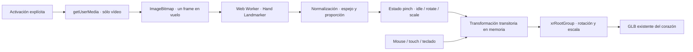

# MED3D · Experiencia XR, fase 1

Fecha de validación: 9 de octubre de 2026. Prototipo local; no publicado.

## Base y aislamiento

- Rama: `phase-xr-experience`.
- SHA base: `2634ab90a1166cf50e99053022e93a304ebc0f1d`.
- Antes de editar se ejecutaron `git status --short`, `git branch --show-current`, `git rev-parse HEAD`, `git log --oneline --decorate -10` y `git fetch origin`. Árbol limpio; `main` y `origin/main` coincidían en ese SHA después del fetch.
- Se ejecutó `git switch main`, se volvió a comprobar el árbol y se creó la rama experimental solicitada.
- Ruta TanStack: `/experiencia-xr`; acceso estático con el basepath actual: `/med3d/experiencia-xr/`.
- Navegación: se añadió únicamente «Experiencia XR». Inicio, Anatomía 3D y Acerca del proyecto continúan; no se recuperaron secciones retiradas.
- Entrega mediante commit local `Add experimental hand-controlled XR heart experience`. El SHA de entrega se informa al cerrar la tarea; puede consultarse con `git log -1` en esta rama.
- Sin push, merge ni deploy. Fase XR 2 no implementada.

## Objetivo y arquitectura

Un corazón 3D independiente, cámara opcional, dos gestos básicos y detección de capacidades WebXR. La página conserva el lenguaje negro/cyan, Geist, líneas finas y footer educativo compartido.



`HandTrackingSession` administra cámara, Worker, cancelación y RAF. `camera.ts` contiene entrada/errores de vídeo. El Worker realiza la inferencia síncrona fuera del hilo de UI. `gestures.ts` concentra normalización y matemáticas sin depender de React, Three o la cámara. La escena lee el objetivo mediante referencias; React sólo recibe cambios de estado breves, como máximo cinco por segundo, y no recibe arrays de landmarks en su estado.

La captura se limita a un máximo de 20 inferencias por segundo, salta frames de vídeo repetidos y nunca acumula una cola. Se solicita vídeo ideal 640 × 480, sin audio. La tasa real depende del equipo. Sólo se necesita un `ImageBitmap` transferible; se cierra después de cada inferencia.

## Modelo piloto y protección anatómica

Se consume `public/models/heart.glb`, el mismo recurso utilizado por el explorador de órganos. No se copia ni se importa el catálogo completo. La comprobación de red de XR registró **un único GLB: heart.glb**; no se descargó el atlas.

- Tamaño: 715.820 bytes.
- SHA-256: `4637d0779ee7c278cf81a326c933528421372bf0aa709188c20308a6ad81b3a1`.
- Fuente registrada: Visible Human / HRA, `VH_Male/v1.2/VH_M_Heart.glb`, CC BY 4.0.
- Se carga una instancia propia mediante GLTFLoader y el Meshopt ya instalado. Los materiales, colores, geometrías y transforms del recurso se mantienen como vienen en el GLB.
- El centrado y encuadre se aplican a grupos contenedores exclusivos de XR. Los gestos modifican únicamente `xrRootGroup`; no escriben en el asset, datos, geometrías o cámara del atlas.
- La iluminación pertenece a esta escena; la presentación puede diferir del tratamiento de materiales del explorador anterior sin alterar ese explorador.
- La escena libera sus propias geometrías/materiales/texturas al desmontar y aborta descargas pendientes; no comparte recursos mutables con el atlas.

La auditoría Git no encontró cambios en `public/models`, `src/features/anatomy`, Home, About o el footer. **No se modificaron GLB, catálogo, geometría, atlas, raycast anatómico, cámaras del atlas ni datos anatómicos.**

## Dependencia, investigación y peso

Se consultaron el registro oficial de npm y la documentación antes de instalar. Dependencia directa fijada: **`@mediapipe/tasks-vision@1.1.0`**, estable publicada el 6 de octubre de 2026; licencia Apache-2.0; sin dependencias transitivas propias. No se eligió la versión nightly.

Fuentes:

- [Guía oficial de Hand Landmarker para web](https://developers.google.com/edge/mediapipe/solutions/vision/hand_landmarker/web_js): configuración, vídeo, resultados e inferencia síncrona; recomienda Worker para evitar bloquear la UI.
- [Configuración web oficial](https://developers.google.com/edge/mediapipe/solutions/setup_web): Chrome/Safari y opciones del runtime.
- [Paquete oficial](https://www.npmjs.com/package/@mediapipe/tasks-vision) y [metadatos de npm](https://registry.npmjs.org/@mediapipe%2Ftasks-vision).
- [Modelo y ficha oficial](https://developers.google.com/edge/mediapipe/solutions/vision/hand_landmarker#models): paquete Hand Landmarker float16, versión 1.
- [Ficha del modelo, página 2](https://storage.googleapis.com/mediapipe-assets/Model%20Card%20Hand%20Tracking%20(Lite_Full)%20with%20Fairness%20Oct%202021.pdf): Apache License 2.0.

Se utilizan los archivos ESM WASM del paquete, importados como URLs de assets Vite, con SIMD verificado y delegado CPU. El modelo `.task` se aloja en `public/xr/`. JS/WASM/modelo se sirven desde el mismo origen y sólo se solicitan al activar las manos. No se utiliza un CDN en ejecución ni `latest` en URLs de recursos.

| Recurso nuevo | Tamaño aproximado sin comprimir | gzip orientativo |
| --- | ---: | ---: |
| JS + CSS de la ruta XR | 35,7 KB | 12,0 KB |
| Worker con Hand Landmarker | 145,4 KB | 44,3 KB |
| Cargador WASM ESM | 335,4 KB | 81,4 KB |
| Binario WASM | 13,0 MB | 3,86 MB |
| Modelo de manos | 7,82 MB | 5,83 MB |
| Total específico XR | **21,33 MB** | **9,83 MB** |

Valores decimales; no son una promesa del tamaño transferido por el hosting. El total incluye recursos diferidos y excluye el corazón y chunks Three/React compartidos ya existentes. El paquete npm completo ocupa aproximadamente 40,56 MB descomprimido; sólo se emite el runtime utilizado. El nuevo binario versionado del repositorio ocupa 7,82 MB; no se versiona WASM de `node_modules` ni `dist`.

Drei ya dependía de MediaPipe 0.10.17. npm conserva esa versión anidada para no alterar su contrato, y XR importa la nueva dependencia directa. No se añadió otra dependencia de Three, Fiber o Drei: se reutilizan sus versiones existentes. `npm ls` también muestra una copia antigua de Three bajo `stats-gl` que ya estaba en el lockfile base; no fue introducida por XR.

Licencias y procedencia del tracking están separadas de anatomía en `public/xr/NOTICE.txt` y `public/xr/LICENSE-mediapipe.txt`. El `.task` tiene SHA-256 `fbc2a30080c3c557093b5ddfc334698132eb341044ccee322ccf8bcf3607cde1`.

## Cámara, privacidad y ciclo de vida

No se solicita cámara al cargar. «Activar control con manos» es el único inicio. La UI muestra permiso pendiente/carga y permite cancelar ambos estados. Si un permiso se concede después de cancelar o desmontar, se detienen inmediatamente los tracks tardíos. Denegación, cámara ausente/ocupada, fallo de MediaPipe, vídeo desconectado y modelo no disponible tienen mensajes sin stack traces y conservan el control manual.

La interfaz indica: «La imagen de la cámara se procesa localmente en tu dispositivo». No se graba vídeo, no se guardan imágenes ni landmarks, no hay analytics de cámara y no se transmiten datos biométricos. Los landmarks y el estado del gesto son transitorios en memoria y se descartan al perder seguimiento o terminar la sesión. La caché normal del navegador puede conservar assets estáticos, nunca frames.

El [aviso general de MediaPipe](https://developers.google.com/edge/mediapipe/solutions/tasks#mediapipe_tasks_privacy_notice) contempla métricas. Por eso no se asume que todo uso de la librería sea libre de telemetría: el Worker local no habilita logging y restringe `fetch` a GET de las URLs exactas del WASM/modelo local, sin credenciales ni redirecciones. Rechaza POST, otros destinos y parámetros adicionales; XHR y WebSocket están deshabilitados en ese Worker. Esta política no modifica las APIs del resto del sitio. La prueba del detector real registró exclusivamente GET del origen local y ninguna petición de subida/telemetría.

«Desactivar control con manos», `pagehide` y el desmontaje detienen todos los tracks, vacían `srcObject`, cancelan RAF/watchdog, eliminan listeners y terminan el gesto. Se solicita `detector.close()` al Worker y se termina el Worker, con un límite de 200 ms si no responde. Fallos de carga tienen timeout de 45 s; una inferencia que no responde se cancela tras 10 s.

Al ocultar la pestaña se pausa la inferencia, no se apaga automáticamente la cámara. Al volver se descartan resultados anteriores y se establece una nueva base del gesto. La UI permite apagarla explícitamente. El vídeo previo se muestra pequeño, en espejo horizontal, y se puede ocultar; ocultar la preview no desactiva la cámara.

## Gestos, suavizado y alternativa manual

- **Pinch:** distancia pulgar–índice relativa a la palma, con corrección de proporción del vídeo. Umbral de entrada 0,30 y salida 0,43 para evitar oscilaciones. Se descartan resultados incompletos/no finitos, etiquetas duplicadas y handedness de baja confianza.
- **Una mano:** al iniciar se guardan centro del pinch y pose actual. El desplazamiento horizontal gira Y y el vertical X. El primer frame no mueve el modelo.
- **Dos manos:** ambos pinches activos; distancia actual/base determina escala relativa. Límites **0,55–1,80**. Distancias iniciales demasiado pequeñas no generan una división inestable.
- **Estabilidad:** filtro exponencial de posición con constante 65 ms; zona muerta de 0,006 para rotación y 0,025 para razón de escala. El grupo visual interpola con constante 55 ms. La zona muerta se mide desde la base, conservando movimientos lentos acumulados.
- **Pérdida/transición:** cambios de mano, número de manos, identidad, modo, saltos grandes o intervalo de más de 250 ms reinician la base sin cambiar bruscamente la pose.
- **Espejo:** la normalización utiliza `x = 1 - x` para corresponder con la preview. El sentido se verificó con datos sintéticos; debe confirmarse físicamente.
- **Mouse/touch:** drag rota, rueda cambia tamaño, dos dedos escalan. La entrada manual tiene prioridad y obliga al tracking a reanclar antes de retomar.
- **Teclado:** enfocar el viewport; flechas rotan, `+`/`-` cambian tamaño y `0` restablece. Botones equivalentes reales, con nombres accesibles y focus visible.
- **Restablecer:** vuelve a rotación XR cero y escala uno; no modifica cámaras globales.

## WebXR y compatibilidad

Se comprueban `mediaDevices/getUserMedia`, contexto seguro y `navigator.xr`; nunca se decide por user-agent. Se consulta por separado `isSessionSupported('immersive-vr')` y `isSessionSupported('immersive-ar')`. Errores o timeout quedan «Sin confirmar», sin falsos positivos. Se actualiza ante `devicechange`.

El CTA de RA sólo explica el resultado: soporte no disponible, no confirmado o detectado con experiencia completa pendiente para otra fase. **No se llama a `requestSession`**, no se promete AR ni se implementan sesiones XR.

HTTPS es necesario en producción; GitHub Pages usa HTTPS. `localhost`/loopback sirven para desarrollo. No se añadieron certificados. Referencias: [getUserMedia](https://developer.mozilla.org/en-US/docs/Web/API/MediaDevices/getUserMedia), [isSessionSupported](https://developer.mozilla.org/en-US/docs/Web/API/XRSystem/isSessionSupported).

Probado en Chrome 155 sobre Windows con renderizado real y vídeo sintético. MediaPipe documenta Chrome/Safari, pero esta implementación necesita Worker, ImageBitmap, OffscreenCanvas, WASM SIMD y contexto gráfico del Worker. Fallos degradan a los controles manuales; Safari/Firefox/Edge, teléfonos físicos y visores no se certifican. El control por cámara requiere permiso y hardware, aunque la API aparezca disponible.

## Validaciones y evidencias

| Validación | Resultado |
| --- | --- |
| `npm run test:xr` | 13 tests correctos: pinch, transiciones, escala/clamps, jitter, pérdida/recuperación, prioridad manual, espejo, APIs ausentes, rechazo/timeout, errores y política de red |
| `npm run typecheck` | Correcto |
| `npm run verify:anatomy` | Correcto; ejecutado **una sola vez** al finalizar la implementación |
| `npm run build` | Correcto; ruta estática nueva y 15 redirecciones anteriores conservadas |
| `git diff --check` | Correcto |
| XR en navegador | Carga real del GLB; drag, rueda, teclado, touch drag y zoom de dos dedos; navegación; errores y recuperación |
| MediaPipe real | Worker/WASM/modelo reales procesaron vídeo de canvas sintético; sin manos físicas; cierre del detector y tracks verificados |
| Tracking simulado | Pinch de una/dos manos cambió el render del corazón; pérdida/recuperación; pausa/reanudación; cleanup al salir |
| Responsive | 1366, 1050, 900, 768, 390: sin desbordamiento; controles accesibles; revisión de capturas |
| Regresión | Home, Anatomía, About, Corazón, Pulmones y Encéfalo a 1366/390: sin errores de página/HTTP ni overflow |
| Apariencia existente | Estilos computados desde MAIN y footer coinciden en las 12 vistas con la evidencia de la auditoría previa del repositorio; sólo crece el menú autorizado |

Windows bloquea el binario nativo de Rollup mediante Application Control. El build se ejecutó con el adaptador Rollup WASM **ya existente** en `.cache/home-redesign/rollup-wasm.cjs`, mediante `NODE_OPTIONS` sólo en esa ejecución. No se cambiaron ajustes del sistema. Continúa el aviso preexistente del chunk Meshopt mayor de 500 KB. La consola de la integración muestra avisos internos de MediaPipe/XNNPACK y la deprecación preexistente `THREE.Clock`, sin excepciones de página.

Para repetir:

```sh
npm run test:xr
npm run typecheck
npm run build
npm run preview -- --host 127.0.0.1 --port 5184
```

En otra terminal, con Playwright ya instalado: `node scripts/xr/browser-qa.mjs`. También acepta ruta del módulo Playwright y ejecutable del navegador como argumentos, o las variables `XR_PLAYWRIGHT_MODULE` / `XR_BROWSER_EXECUTABLE`; `XR_QA_ORIGIN` permite otro origen. Los tests matemáticos usan el soporte strip-types de Node 22.6+; validación realizada con Node 24.15.0. No se añadió Playwright como dependencia del producto.

Evidencias locales, no versionadas por la política existente de `.cache/`:

- `.cache/xr-phase1/browser-qa.json`: escenarios XR y peticiones del detector real.
- `.cache/xr-phase1/verify-anatomy.txt`, `typecheck.txt`, `asset-sizes.json`.
- `.cache/xr-phase1/regression-after/`: capturas y `visual.json` de las seis páginas en desktop/móvil.
- `.cache/xr-phase1/regression-style-comparison.json`: comparación de las 12 vistas existentes.

Capturas principales en `.cache/xr-phase1/`:

1. `01-desktop-inicial.png`: página inicial, sin cámara solicitada.
2. `02-corazon-cargado.png`: recurso real tras drag manual.
3. `03-permiso-pendiente-simulado.png`: estado pendiente simulado, no diálogo real del sistema.
4. `04-mediapipe-real-video-sintetico.png`: detector real con vídeo de canvas, cero manos físicas.
5. `05-una-mano-rotacion-simulada.png`: landmarks sintéticos inyectados por el harness.
6. `06-dos-manos-escala-simulada.png`: landmarks sintéticos inyectados por el harness.
7. `07-sin-webxr.png`: fallback de AR.
8. `08-mobile.png`: ancho 390; también se guardaron los otros cuatro anchos.

Las capturas 03–06 llevan **«SIMULACIÓN QA · Sin webcam física»**. La simulación sólo existe en el script de pruebas, no en la aplicación ni en una ruta pública. No se añadió un modo debug al producto.

## Limitaciones y prueba manual pendiente

No se probó una webcam física, iluminación real, detección efectiva de dedos, oclusiones, comodidad de gestos, latencia percibida ni rendimiento en móvil físico. Las pruebas sintéticas validan integración/matemáticas/cleanup, no la calidad del detector con una persona. Tampoco se probaron permisos reales del navegador o sistemas operativos, ni soporte XR confirmado por un visor real.

Antes de aprobar físicamente: abrir la ruta por localhost, activar cámara, comprobar preview espejo, pinch y rotación en ambos ejes; hacer dos pinches y separar/acercar hasta los límites; soltar y recuperar una mano; mover lentamente para valorar jitter; combinar mouse; restablecer; ocultar/mostrar preview; cambiar de pestaña; desactivar y comprobar el indicador físico; reactivar y salir por el logo/navegación para comprobar que la cámara se apaga. Repetir denegando permiso y con cámara ocupada. No se promete precisión clínica ni compatibilidad universal.

## Archivos

Nuevos:

```text
docs/xr-phase1-delivery.md
public/xr/hand_landmarker.task
public/xr/LICENSE-mediapipe.txt
public/xr/NOTICE.txt
scripts/xr/browser-qa.mjs
scripts/xr/capabilities.test.mjs
scripts/xr/gestures.test.mjs
src/routes/experiencia-xr.tsx
src/features/xr/XrExperiencePage.tsx
src/features/xr/XrHeartScene.tsx
src/features/xr/HandTrackingSession.ts
src/features/xr/hand-tracking.worker.ts
src/features/xr/useHandTracking.ts
src/features/xr/useManualControls.ts
src/features/xr/gestures.ts
src/features/xr/camera.ts
src/features/xr/capabilities.ts
src/features/xr/networkPolicy.ts
src/features/xr/types.ts
src/features/xr/xr.css
```

Modificados: `package.json` (dependencia y tests), `package-lock.json` (resolución), `src/components/SiteHeader.tsx` (un enlace), `src/routeTree.gen.ts` (generación TanStack), `scripts/static-routes.mjs` (ruta estática/sitemap). No se modifican estilos globales.

## FASE XR 2 · Sólo roadmap, no implementado

Posibles objetivos para una solicitud futura: Meta Quest; sesiones `immersive-vr`/`immersive-ar`; passthrough cuando el dispositivo lo permita; hand tracking nativo WebXR; colocación del modelo en el espacio real; anchors; selección mediante pinch y aislamiento anatómico. Primero conviene realizar la prueba física y ajustar umbrales del MVP con esa evidencia. Esta entrega termina en fase 1.
