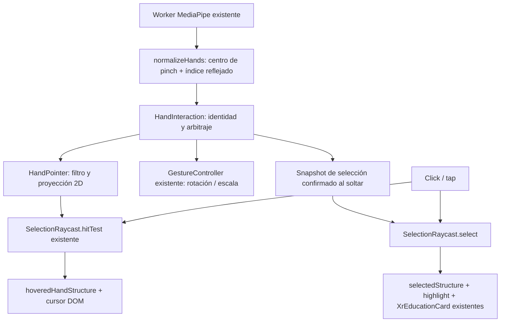

# MED3D XR 1.2 · Puntero de índice y selección mediante pinch

Validación local: 9 de octubre de 2026. Preparado para calibración física; no publicado.

## Base y alcance

- Rama: `phase-xr-experience`.
- SHA base: `a2361c1b9b1eec182fc53536351c4afc79160456`.
- Antes de editar se ejecutaron `git status --short`, `git branch --show-current`,
  `git rev-parse HEAD` y `git log --oneline --decorate -8`. Coincidieron rama y SHA;
  el árbol estaba limpio.
- Commit local: `Add hand-pointer anatomical selection to XR heart`.
- Sin push, merge, deploy, XR 1.3 ni XR Fase 2. No se inicia ninguna sesión WebXR.

Archivos creados:

- `src/features/xr/handConfig.ts`
- `src/features/xr/handPointer.ts`
- `src/features/xr/handInteraction.ts`
- `src/features/xr/useHandPointer.ts`
- `scripts/xr/hand-interaction.test.mjs`
- `scripts/xr/hand-selection-browser-qa.mjs`
- Este documento.

Archivos modificados:

- `src/features/xr/HandTrackingSession.ts`, `useHandTracking.ts`, `types.ts`:
  contrato de entrada gestual, independiente de la cámara.
- `src/features/xr/gestures.ts`: índice normalizado, parámetros existentes con
  nombre, prioridad manual observable y suspensión de rotación durante candidato.
- `src/features/xr/selection.ts`, `XrHeartScene.tsx`: separar consulta de raycast y
  confirmación, dentro del mismo mecanismo de XR 1.1.
- `src/features/xr/XrExperiencePage.tsx`, `xr.css`: conectar el cursor, indicador e
  instrucciones de interacción.
- `scripts/xr/selection.test.mjs`: integración de puntero con el corazón real.

## Arquitectura

La inspección previa cubrió `HandTrackingSession`, Worker, `useHandTracking`,
`gestures`, `selection`, `pointerIntent`, escena, página y ficha educativa.
El punto de extensión está después de normalizar cada resultado del Worker:



`HandTrackingSession` conserva la adquisición de vídeo, Worker, cancelación,
watchdog y frecuencia de inferencia. Su consumidor cumple `HandTrackingInput`;
la cámara no conoce raycasts, fichas ni DOM del cursor.

`HandInteraction` es una clase testeable sin cámara, DOM, Three.js ni React.
Recibe puertos para consultar el rectángulo, consultar anatomía, confirmar un
resultado y dibujar el cursor. `useHandPointer` conecta esos puertos mediante refs,
actualiza el DOM y gestiona interrupción manual y caducidad de resultados.

## Índice, espejo y cursor

Se utiliza **landmark 8**: `indexX = 1 - points[8].x`, `indexY = points[8].y`.
El espejo coincide con el preview existente; el centro entre pulgar e índice
continúa siendo la entrada de manipulación, sin sustituirlo por el índice.

El cursor tiene un filtro exponencial independiente de 45 ms, sin dead zone.
Su proyección ajusta el rectángulo del vídeo dentro del canvas con su proporción
real (`videoWidth / videoHeight`), equivalente a un ajuste `contain`, centrado.
Así no estira ni inventa coordenadas 3D. En un canvas más ancho o alto pueden quedar
márgenes fuera del área controlada por el vídeo.

Se calcula sobre `getBoundingClientRect()` del canvas real en cada resultado,
incluidos desplazamiento de página y cambios responsive. Primero se valida la
coordenada cruda: si está fuera de [0, 1], no es finita o el rectángulo no es válido,
se oculta el cursor, se reinicia el filtro y no se hace raycast. No se clampa al borde.

El círculo mide 14 px, tiene `pointer-events: none` y `aria-hidden`. Cambia
discretamente de borde/fondo al apuntar una estructura y durante el pinch candidato.
No hay texto, esqueleto de mano, puntos adicionales ni coordenadas de depuración.
No se tocan materiales para hover.

## Estados, prioridades y selección

| Estado interno | Entrada / comportamiento |
| --- | --- |
| `idle` | Sin mano válida, interrupción manual o pérdida de seguimiento |
| `pointing` | Mano primaria abierta; cursor y hover sin ficha |
| `candidate` | Transición abierta → pinch de la primaria; modelo sin rotación nueva |
| `rotate` | Pinch movido, sostenido, ya cerrado al adquirir tracking o pinch secundario |
| `scale` | Dos pinches; cancela inmediatamente cualquier candidato |

Al comenzar un candidato se guardan timestamp, posición del centro del pinch,
posición del cursor, resultado anatómico y pose objetivo actual. Se mantiene
caliente el filtro/anclaje de `GestureController`, pero se suspende la escritura
de rotación. Un pinch corto estable no modifica el objetivo del modelo.

Liberar dentro de 280 ms confirma **el resultado del raycast al comenzar el pinch**,
si la posición sigue siendo válida. No se vuelve a elegir otro objetivo en el frame
de liberación. El resultado pasa al mismo `select` que utiliza mouse/touch.

Superar 0,025 unidades normalizadas de altura de vídeo —con corrección de proporción
en X— cancela permanentemente la selección para ese pinch y permite rotar. Mantener
el pinch durante 330 ms también activa rotación, incluso antes de desplazarse.
El controlador conserva sensibilidad, filtro, zona muerta y pose de referencia
originales. Volver al origen o soltar después de rotar nunca selecciona.

Una liberación entre el máximo corto y el umbral de hold no selecciona ni inicia
una rotación nueva. Los valores son iniciales, no una calibración definitiva.

Dos pinches tienen prioridad sobre cualquier otro estado. Se reutiliza la escala
por distancia relativa y sus límites **0,55–1,80**. Al pasar de dos pinches a uno se
reancla la rotación; no se convierte el pinch restante en candidato de selección.

## Mano primaria, interrupciones y recuperación

Se conserva el ID/handedness primario mientras esté presente. Sólo al adquirir
una primaria nueva se elige de forma determinista por ID, nunca por la posición
en el array de MediaPipe. Que aparezca otra mano abierta no mueve el cursor.
Un pinch de la secundaria puede manipular, pero no selecciona usando el cursor
de la primaria. Dos pinches escalan normalmente.

Si desaparece la primaria, se oculta el cursor y se cancela el gesto/candidato,
preservando pose y selección. Una mano restante puede adquirirse en el siguiente
resultado con una base nueva. Saltos espaciales grandes y huecos de tracking
también invalidan el candidato. Un pinch ya cerrado al reaparecer puede manipular,
pero necesita abrirse y volver a cerrarse para seleccionar.

Un temporizador de 250 ms sin resultados elimina un cursor obsoleto y termina el
gesto; no hace raycast ni borra la ficha. La protección original de cámara/Worker
continúa gestionando errores y cierre. Ocultar pestaña, apagar cámara, navegar y
desmontar limpian también el nuevo estado.

Mouse, touch, rueda, teclado y botones conservan prioridad. La revisión de entrada
manual invalida candidatos incluso si el click ocurre entre dos inferencias. La
interacción directa con la ficha también suspende las manos mientras dura el input.
Después hay una breve exclusión de 250 ms y se adquiere una base nueva, sin arrastrar
el filtro previo. Escape sigue limpiando la selección y cancela candidatos pendientes.

## Raycast y reutilización de XR 1.1

`SelectionRaycast` ofrece `rect`, `hitTest` y `select`. Click/tap consulta y confirma;
el puntero consulta para hover y confirma únicamente después de un candidato válido.
No existe un segundo catálogo, seleccionador o panel para manos. Una confirmación
de malla sólo se admite si sigue perteneciendo al recurso cargado.

El raycast conserva cámara real, matrices renderizadas de los grupos XR,
rotación/escala actuales y colección de 14 mallas. Se ejecuta como máximo una vez
por resultado relevante de manos con puntero válido, además de los clicks/taps.
Resultados duplicados/antiguos no repiten consultas; durante escala se oculta el
cursor y se omite el hover. No hay raycast en el bucle de render.

`hoveredHandStructure` es transitorio y no cambia `selectedStructure`. El pinch
puede cambiar A → B directamente. Un pinch corto con un **resultado vacío real**
limpia la selección. Ausencia de recurso, coordenada inválida, pérdida de mano o
inferencia interrumpida no se interpretan como vacío y no deseleccionan.

Se reutilizan sin cambios `XrEducationCard`, mapping, `STRUCTURES`, `EDUCATION`,
`SOURCE_CREDIT`, highlight temporal y restauración de materiales. La cobertura
sigue siendo 14 mallas identificadas: 9 notas completas y 5 papilares parciales.
Sólo se alcanzan superficies visibles; no se añaden cortes, transparencia,
explosión o subdivisiones. La ficha abierta permite seguir apuntando, rotando y
escalando. Se mantienen el mismo canvas y una sola descarga del GLB.

## Accesibilidad, privacidad y rendimiento

Las manos son opcionales. Permanecen click/tap, drag, teclado de manipulación,
Escape, botones reales, foco visible y anuncio educativo de selección. No se
anuncian las estructuras de hover continuamente; el indicador de interacción
utiliza palabras breves, sin estados internos ni números técnicos.

No cambian preview, espejo, mostrar/ocultar cámara ni botón de desactivación.
Se mantiene procesamiento local, sin grabación, almacenamiento de imágenes o
landmarks, analytics de cámara ni uploads. Sólo se conservan muestras derivadas
transitorias necesarias para el gesto; no hay historial persistente.

El Worker, `.task`, WASM, política de red y MediaPipe **1.1.0** no cambian.
**Cero dependencias nuevas.** Se conserva el máximo de 20 inferencias/s y un frame
en vuelo. El cursor actualiza una ref DOM por resultado; no usa un RAF nuevo ni
`setState` con landmarks. Los estados semánticos siguen pasando por el publicador
existente, limitado a cinco actualizaciones/s. Hover no clona materiales.

## CALIBRACIÓN FÍSICA PENDIENTE

No se utilizó webcam física ni móvil físico. Estos valores no están calibrados
con una persona y deben revisarse antes de dar por validada la experiencia física.
Los parámetros están centralizados en `src/features/xr/handConfig.ts`.

| Parámetro | Valor inicial | Qué observar |
| --- | --- | --- |
| Short pinch max | 280 ms | Facilidad para cerrar/abrir, clicks perdidos y falsos positivos |
| Movement threshold | 0,025; distancia con X corregida por aspecto | Seleccionar sin girar frente a comenzar una rotación intencionada |
| Pinch hold | 330 ms | Inicio de rotación lenta y liberaciones entre 280–330 ms |
| Cursor smoothing | 45 ms exponencial | Temblor frente a latencia percibida al apuntar piezas pequeñas |
| Cursor dead zone | Ninguna | Precisión fina; evitar zonas que impidan apuntar |
| Pinch enter | Ratio < 0,30 (existente) | Entrada al juntar dedos; distancia a cámara y tamaño de mano |
| Pinch exit | Ratio ≥ 0,43 (existente) | Liberación fiable, histéresis y oclusión de pulgar/índice |
| Rotation sensitivity | 2π rad por unidad normalizada (existente) | Sensación de giro y cambio al superar el umbral |
| Rotation dead zone / smoothing | 0,006 / 65 ms (existentes) | Movimiento lento, estabilidad y comodidad |
| Tracking gap / cursor caducado | 250 ms | Ocultaciones con CPU lenta, iluminación deficiente y oclusiones |
| Discontinuidad de mano | 0,25 normalizado (existente) | Cambios de identidad y movimientos rápidos |
| Exclusión tras input manual | 250 ms | Reanclaje cómodo y ausencia de conflicto entre inputs |
| Escala | 0,55–1,80 (existente) | Se verifica su continuidad; no recalibrada en XR 1.2 |

Prueba física sugerida: apuntar y seleccionar ambos ventrículos, repetir pinches
cortos sin desplazar el corazón, rotar despacio con hold, rotar con movimiento,
escalar con dos manos, tapar/reintroducir la mano y alternar mouse con manos.
Observar precisión del índice, sensación del cursor, facilidad del pinch, falsos
positivos, latencia, iluminación, oclusiones y handedness. La estabilización por
identidad no es un sistema biométrico de seguimiento de personas: una clasificación
inestable puede provocar ocultación/reanclaje. No se ajustaron umbrales a partir de
las pruebas sintéticas ni se inició XR 1.3.

## Validación y evidencias

- `npm run test:xr`: **39/39 PASS**. Conserva 21 pruebas anteriores; añade 17 de
  interacción/proyección y una integración con el GLB real en tres poses/escalas,
  al menos dos superficies por pose, metadata/ficha correcta y materiales intactos.
- `npm run typecheck`: PASS.
- `npm run verify:anatomy`: PASS; **una sola ejecución al final de XR 1.2**.
- `npm run build`: PASS, 4 páginas estáticas y 15 redirecciones. Se utilizó el
  adaptador Rollup WASM local existente mediante
  `NODE_OPTIONS=--require=./.cache/home-redesign/rollup-wasm.cjs`, debido a la
  restricción del binario nativo en este entorno Windows. Sin cambios de dependencias.
  Persiste el aviso del chunk Meshopt existente mayor de 500 KB.
- `git diff --check`: PASS.

QA nuevo: `scripts/xr/hand-selection-browser-qa.mjs`, **13 resultados PASS**.
Chromium real ejecuta código de producción, geometría real, raycasts y fichas;
la cámara y los landmarks son sintéticos. Comprueba puntero, hover, pinch corto
sin giro (capturas del modelo idénticas antes/después de limpiar highlight), A → B,
movimiento/hold sin ficha accidental, escala, ficha abierta, pérdida/recuperación,
orden de manos, vacío, fuera de canvas, prioridad manual, Escape, inferencia parada,
desactivación y touch manual posterior. Las comparaciones de pose excluyen sólo
cursor y preview para no confundir cambios del vídeo con cambios del corazón.

Responsive probado a **1366, 1050, 900, 768 y 390 px**, midiendo la posición real
del cursor y ausencia de overflow. Mobile conserva el bottom sheet de XR 1.1.

Regresiones ejecutadas sin modificar esos scripts:

- `scripts/xr/browser-qa.mjs`: 16 resultados PASS; incluye MediaPipe/Worker/WASM
  reales con vídeo sintético, mouse, touch, teclado, permisos/errores, gestos,
  privacidad de red y limpieza del ciclo de vida.
- `scripts/xr/selection-browser-qa.mjs`: 3 grupos PASS; selección manual, ficha,
  canvas persistente, materiales y selección manual con MediaPipe real activo.
- Home, Anatomía, About, Corazón, Pulmones y Encéfalo: carga a 1366 px, sin errores
  JS/HTTP ni overflow. Aviso previo de `THREE.Clock` en atlas/exploradores.

Ejecutar contra un servidor local del build (por defecto, puerto 5184):

```sh
node scripts/xr/hand-selection-browser-qa.mjs [ruta-modulo-playwright] [ejecutable-chromium]
```

También admite `XR_QA_ORIGIN`, `XR_PLAYWRIGHT_MODULE` y `XR_BROWSER_EXECUTABLE`.
No se instala Playwright en el proyecto. Los artefactos quedan en
`.cache/xr-hand-selection/`, ignorados por Git. Las siete capturas se revisaron
visualmente y llevan marca de simulación inyectada exclusivamente por el script QA:

1. [Cursor apuntando](../.cache/xr-hand-selection/01-cursor-apuntando-simulado.png)
2. [Hover sobre estructura](../.cache/xr-hand-selection/02-hover-estructura-simulado.png)
3. [Selección por pinch](../.cache/xr-hand-selection/03-pinch-seleccion-simulado.png)
4. [Ficha de estructura B](../.cache/xr-hand-selection/04-ficha-estructura-b-simulada.png)
5. [Rotación con manos](../.cache/xr-hand-selection/05-rotacion-manos-simulada.png)
6. [Escala con dos manos](../.cache/xr-hand-selection/06-escala-dos-manos-simulada.png)
7. [Mobile](../.cache/xr-hand-selection/07-mobile-pinch-simulado.png)

## Auditoría y límites

El código de producto sólo cambia dentro de `src/features/xr/`. Fuera de XR,
únicamente hay pruebas y este documento. No se modifican GLB, geometrías,
materiales originales, transforms originales, catálogo, IDs, datos anatómicos,
atlas, explorador Corazón, Home, About u órganos existentes. Tampoco rutas,
dependencias, preview, Worker de MediaPipe o modelo `.task`.

`heart.glb` conserva 715.820 bytes y SHA-256
`4637d0779ee7c278cf81a326c933528421372bf0aa709188c20308a6ad81b3a1`.

La cobertura interior y la información educativa son las mismas de XR 1.1.
El ajuste de proporción limita el cursor al área de vídeo encajada en el canvas;
no existe selección en 3D a partir de profundidad de la mano. La precisión,
latencia, ergonomía y umbrales reales siguen pendientes de la prueba física.
Capability detection de WebXR permanece sin sesiones, passthrough, anchors o planos.
